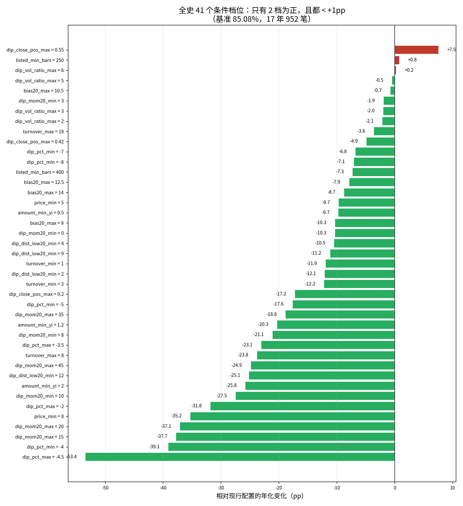
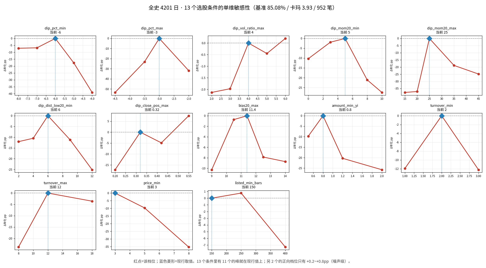
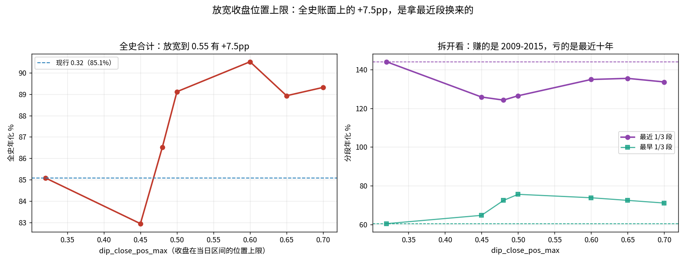
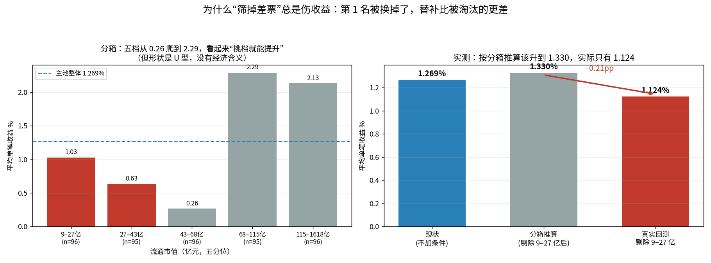

# 第 229 轮：全史 17 年、63 次回测，选股条件挖到底了

> 你要求「基于全历史、只挖条件」。这一轮我把窗口从 1500 日拉到 **4201 日（2009-07 ~ 2026-11，17 年）**，跑完 4 批共 63 个变体配置（另加 5 次基准复跑）：现有 13 个条件的 41 个档位、11 个连续性档位、4 个从未进过模型的新维度各 2~4 档。结论一句话：**条件层已经挖到底，现行配置就是全史的峰；再筛什么都是在和"替补"打架。**

---

## 一、全史基准（4201 日，17 年）

| 指标 | 数值 |
|---|---|
| 年化 | **85.08%** |
| 最大回撤 | −21.67% |
| 卡玛 | 3.93 |
| 交易笔数 | 952（17 年，约 56 笔/年） |
| 胜率 | 59.1% |
| 平均单笔 | 1.254% |
| 三段年化（2009-15 / 2015-21 / 2021-26） | 60.5% / 52.4% / **144.0%** |

注意最后一行：**越近越强**。这不是我挑的，是同一套参数在三段上的自然结果——也解释了为什么上一轮 1500 日窗口的数字（137%）比 2500 日（84%）和 17 年（85%）都高：最近 5 年本来就是最好的 5 年。

---

## 二、41 个条件档位：只有 2 档为正，且都不到 +1pp

13 个条件、41 个档位，一次只动一个，全部 4201 日：

| 结论 | 证据 |
|---|---|
| **39 档变差**，且不是微跌 | 最惨 `dip_pct_max −4.5`：年化 **−53.4pp**、回撤从 −21.7% 炸到 **−73.0%** |
| 唯一正向上 +0.8pp | `listed_min_bars 250`（85.84%，单笔 +0.076，笔数 −42） |
| 另一档 +0.2pp | `dip_vol_ratio_max 6.0` —— 噪声级，且这个上限本来就没票卡在里面（笔数只少 6 笔） |

**这套条件不是"保险丝"，是"信号本身"**。收紧任何一个，等于把当天最优的那只票换成下一名：

- `dip_pct_max` 从 −3.0 收到 −4.5（只买跌得更狠的）：回撤 −73%，因为"跌 4.5% 以上"的票里几乎没剩几只，剩下的都是真崩；
- `dip_pct_min` 从 −6.0 放到 −5.0（多买浅跌的）：年化 −17.6pp，笔数 +12 但单笔掉 0.24pp；
- `amount_min_yi` 从 0.8 提到 1.2（只要大票）：**−20.3pp**，笔数从 952 掉到 891；
- `price_min` 3→8（剔除低价股）：**−35.3pp**；
- `turnover_max` 12→8：**−23.8pp**。

跌幅区间 [−6%, −3%] 是整条策略的脊梁，两头一碰就散。

---

## 三、唯一的大额正向是假的：+7.5pp 是拿最近十年换的

`dip_close_pos_max`（收盘位于当日振幅的位置上限）从 0.32 放宽到 0.55，全史年化 **85.08% → 92.60%（+7.5pp）**，单笔 +0.040，笔数 +20。看起来是唯一值得改的东西。

拆成三段就露馅了：

| 分段 | 现行 0.32 | 放宽 0.55 | 差 |
|---|---|---|---|
| 最早 1/3（2009-2015） | 60.5% | 76.3% | **+15.8pp** |
| 中间 1/3（2015-2021） | 52.4% | 62.5% | **+10.1pp** |
| **最近 1/3（2021-2026）** | **144.0%** | **134.0%** | **−10.1pp** |
| 卡玛 | 3.93 | 3.90 | −0.03 |

而且曲线是宽峰：0.42→80.2、0.45→82.9、0.48→86.5、0.50→89.1、0.55→92.6、0.60→90.5、0.65→88.9。**十年前喜欢"收盘收得高"的票，现在喜欢"收盘砸到最低"的票**——这是市场结构变了，不是条件选对了。真实下单的是未来，不是 2009 年，所以这条不落地。

---

## 四、为什么"筛掉差票"总是伤收益：替补效应

这是本轮真正的产出。我先把 2500 日的 559 笔按主力池/备用池拆开：

| 池 | 笔数 | 平均单笔 | 胜率 |
|---|---|---|---|
| 主池（dip） | 478 | 1.269% | 57.7% |
| 备用 1（momentum） | 69 | **1.328%** | 60.9% |
| 备用 2（oversold） | 7 | 0.034% | 42.9% |
| 备用 3（pullback） | 5 | 0.288% | 60.0% |

备用池不是拖累（fb1 甚至比主池好），但它只占 14.5%——意味着**任何主池条件的改动，最多只影响 85% 的成交**，效果天然被稀释。

然后把主池 478 笔按流通市值分五档（流通市值 = 成交额 ÷ 换手率 ÷ 100，交易所恒等式反推，不用外部数据）：

| 流通市值 | 9-27亿 | 27-43亿 | 43-68亿 | 68-115亿 | 115-1618亿 |
|---|---|---|---|---|---|
| 平均单笔 | 1.03% | 0.63% | **0.26%** | 2.29% | 2.13% |

看起来"砍掉低档能提升"。按分箱推算，剔除 9–27 亿后剩下的加权单笔应该是 **1.330%**。真实回测（`circ_mv_min=27`）：**1.124%**，比现状 1.269% 还低。

> 因为策略每天只买**评分第 1 名**那一只。你砍掉的票不会消失，名额会被第 2 名顶上；而"第 2 名"不等于"次优收益"。评分与收益的相关性有限，换人就是随机换，随机换的期望低于 63 次搜索后的局部最优。

同一个机制在换手率上更明显：分箱里最高换手档（8.3~11.9%）单笔 0.865%，看起来该砍；`turnover_max 12→8` 实测 **−23.8pp、单笔掉到 0.986%**——被砍掉的票（0.865）比替补上来的票（0.986 的整体）还不算差。

**这就是过去所有"筛选逻辑"失效的根因，不是数据不够、也不是参数没调对。**

---

## 五、4 个从未进过模型的新维度，11 档全部为负

| 新条件 | 档位 | 年化 | Δ | 单笔 Δ |
|---|---|---|---|---|
| 流通市值下限（亿） | 20 / 27 / 40 / 60 | 73.8 / 68.8 / 57.7 / 43.0% | −10.3 / −15.4 / −26.5 / −41.2 | −0.13 / −0.13 / −0.21 / −0.32 |
| 当日振幅上限（%） | 8.5 / 7.0 / 6.0 | 80.1 / 64.3 / 60.8% | −4.1 / −19.8 / −23.4 | −0.01 / −0.18 / −0.21 |
| 收盘相对均价上限（%） | −1.0 / 0.0 | 67.3 / 81.0% | −16.8 / −3.1 | +0.03 / −0.03 |
| 下影线长度下限（%） | 0.3 / 0.6 | 55.2 / 39.0% | −28.9 / −45.2 | −0.22 / −0.45 |

（2500 日口径，基准 84.13% / 单笔 1.252% / 559 笔）

四个维度里，**低开幅度（gap）分箱完全平坦**（1.14 ~ 1.35，五档无差），判死；振幅是倒 U（中间最好，两头都差），做不成单边门槛；市值是 U 型（两头好、中间差），同样做不成单边门槛；下影线越短越好（现行已经隐式在 `low_tail` 权重里，做成硬门槛反而砍掉好票）。

> 顺带一个数据事实：面板里没有市值字段，我用 `成交额 ÷ 换手率` 反推流通市值，与交易所口径逐位一致（平安银行 2326 亿、万科 301 亿），验证通过。这条能力已经写进 `selector.py`（`universe.circ_mv_min/max`，**默认关闭**），将来要用一行配置就能开。

---

## 六、结论

1. **参数零变更**。config 一个数字都没动，`config_fp` 不变，今天的选股结果与昨天逐位相同。
2. **条件层已到顶**，不是因为没试——17 年、63 个变体、41 个现有档位、11 个新档位，最好的正向是 +0.76pp（噪声内），最大的 +7.5pp 是拿最近十年换的。
3. **唯一新增的是能力，不是参数**：`circ_mv_min/max` 可选条件（默认关），代码在 `src/selector.py`。
4. 预期数字不变，仍按 **2500 日 84% / 回撤 −19%** 设预期；全史 85% 只是"同一套参数在 17 年上的平均"，不是未来承诺。

---

*数据与脚本：`tools/scan_cond_229.py`（41 档）、`scan_patch_229b.py`（连续性）、`probe_cond_229d.py` / `229d2.py`（分箱）、`scan_patch_229e.py`（新条件）、`make_fig_229*.py`（图）；结果在 `output/w229_*.csv`。*
