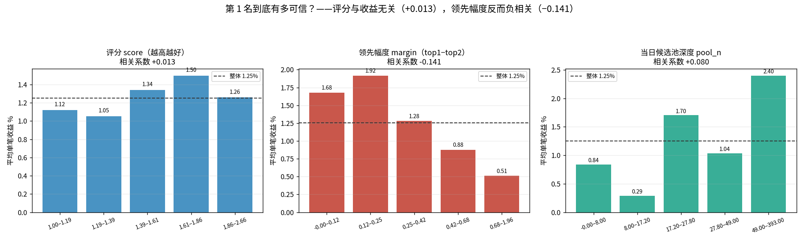
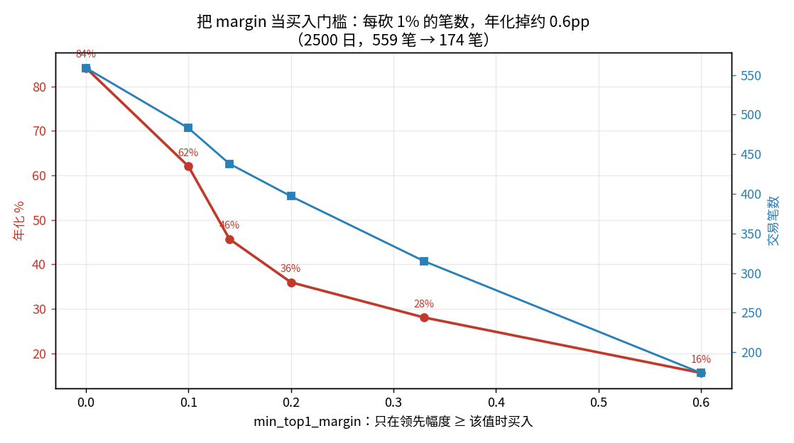
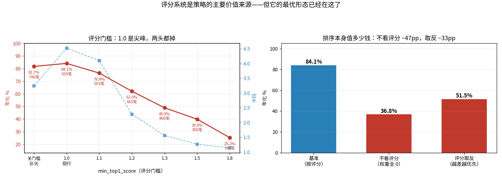

# 第 230 轮：条件挖到底之后，我去审了"第 1 名"本身

> 229 轮把 63 个条件变体跑完，结论是"筛什么都伤收益"。这轮换个问法：**既然筛出来的第 1 名换不得，那它到底有多可信？** 结果挖出一个之前 200 多轮从没量化过的事实——评分（score）与收益的相关系数只有 **+0.013**，而"领先第 2 名多少"（margin）是 **−0.141**。但把评分整个拿掉，年化掉 47pp。

---

## 一、三个诊断：谁在解释收益

对 2500 日的 559 笔成交逐笔取 T 日盘后的三个量，分五档看单笔：

| 变量 | 相关系数 | 五档单笔 | 判断 |
|---|---|---|---|
| 评分 `score` | **+0.013** | 1.12 / 1.05 / 1.34 / 1.50 / 1.26 | **无单调、无信息** |
| 领先幅度 `margin = top1−top2` | **−0.141** | 1.68 / **1.92** / 1.28 / 0.88 / **0.51** | 单调递减 |
| 候选池深度 `pool_n` | +0.080 | 0.84 / 0.29 / 1.70 / 1.04 / 2.40 | 池越深越好（已有池深分档） |

`margin` 与 `score` 的相关只有 +0.361、与 `pool_n` 只有 −0.171，是独立的一维。

**为什么"领先越多越差"**：margin 大 = 第 1 名在某维度上极端（负乖离特别深 / 缩量特别极致）= 越像**个股独跌**；而 margin 小 = 一堆票同分挤在一起 = 当天是**全市场同跌**，修复是普遍性的。策略赚的正是后者——这与"刀口保护"（个股独跌不参与）是同一件事的两个侧面。

---

## 二、margin 做买入门槛：单笔涨 24%，年化掉 44pp

只在 margin ≥ 门槛时买：

| 门槛 | 年化 | 卡玛 | 笔数 | 单笔 |
|---|---|---|---|---|
| 不设 | **84.1%** | 4.52 | 559 | 1.252% |
| 0.10 | 62.0%（−22.1） | 2.39 | 483 | 1.100% |
| 0.14 | 45.7%（−38.4） | 1.60 | 438 | 0.861% |
| 0.20 | 36.0%（−48.1） | 0.93 | 397 | 0.732% |
| 0.33 | 28.1%（−56.0） | 0.80 | 315 | 0.674% |
| 0.60 | 15.7%（−68.5） | 0.54 | 174 | 0.567% |

门槛 0.25 时单笔确实升到 **1.557%（+24%）**，但笔数掉到 261（−53%），年化只剩 **40.0%**。

> 这是三乘数（单笔 × 笔数）在起作用：单笔 ×1.24、笔数 ×0.47，净值必然腰斩。**这笔生意里，笔数是命。**

---

## 三、margin 改成"下注倍率"：卡玛升了，但只有最早那一段升

照常买、只把 margin 大的那些笔降仓（笔数不变）：

| 方案 | 年化 | 回撤 | 卡玛 | 笔数 | 三段年化 |
|---|---|---|---|---|---|
| 基准 | 84.13% | −18.62% | 4.52 | 559 | 11 / 167 / 94 |
| A 温和（≤0.25→1.0，≤0.42→0.85，其余 0.7） | 81.63%（−2.50） | **−17.21%** | **4.74（+0.22）** | 587 | 13 / 159 / 87 |
| B 中性 | 75.43%（−8.70） | −17.21% | 4.38（−0.14） | 593 | 13 / 145 / 80 |
| C 激进 | 79.93%（−4.20） | −17.21% | 4.64（+0.12） | 584 | 15 / 154 / 83 |

A 组是唯一"卡玛改善"的方案（+4.9%），回撤少 1.4pp。但三段里**中段 −8pp、最近段 −7pp**，只有 2009-2015 那一段是升的（+2pp）——和 229 轮 `close_pos` 一模一样的形状：用最近十年去换早期。**不落地。**

---

## 四、决定性实验：评分值多少钱

如果 score 与收益无关（+0.013），那把评分拿掉应该没影响吧？实测：

| 方案 | 年化 | 卡玛 | 笔数 | 单笔 |
|---|---|---|---|---|
| 基准（按评分） | **84.1%** | 4.52 | 559 | 1.252% |
| 不看评分（权重全 0） | **36.8%** | 0.73 | 766 | 0.426% |
| 评分取反（越差越优先） | **51.5%** | 1.97 | 808 | 0.721% |

**−47pp 和 −33pp**。所以评分非常重要——那前面"+0.013"怎么解释？

> 因为样本被截断了：所有成交票的 score 都 **≥ 1.0**（门槛），落在 1.0~2.66 这个窄区间里。**在这个区间内排序没有区分度，但 1.0 以下极差。**
>
> 也就是说，评分系统的真实作用不是"连续排序"，而是"**一刀切**"：切掉评分低的，剩下的一堆差不多。这解释了 226/228 两轮为什么调权重、换因子、改占比全部无效——它们只改变"1.0 以上谁排第一"，而那一层本来就没有信息。

---

## 五、评分门槛重扫：1.0 就是尖峰

`min_top1_score = 1.0` 是第九十五轮定的，此后 130 多轮没动过，是**唯一没被重扫的条件**：

| 门槛 | 年化 | 卡玛 | 笔数 | 单笔 |
|---|---|---|---|---|
| 关掉（0.9） | 81.7%（−2.4） | 3.24（−1.28） | 746 | 0.980% |
| **1.0（现行）** | **84.1%** | **4.52** | 559 | 1.252% |
| 1.1 | 76.4%（−7.7） | 4.10 | 503 | 1.243% |
| 1.2 | 62.0%（−22.1） | 2.28 | 443 | 1.199% |
| 1.3 | 48.9%（−35.2） | 1.56 | 400 | 1.060% |
| 1.5 | 39.9%（−44.3） | 1.26 | 300 | 1.143% |
| 1.8 | 25.2%（−58.9） | 1.14 | 161 | 1.298% |

上下都掉，且**关掉门槛只掉 2.4pp 年化，卡玛却掉 1.28**——门槛的真实价值是控回撤，不是提收益。这条也不动。

---

## 六、结论

1. **参数零变更**，`config_fp` 不变。
2. 条件层（229 轮 63 个变体）和排序层（本轮 16 个变体）都已经到顶。两者的关系现在说清楚了：**alpha 来自条件筛选 + 一道评分门槛，不来自门槛以上的精细排序。**
3. 新增三个**默认关闭**的能力，将来若要用，一行配置即可：
   - `execution.min_top1_margin` / `max_top1_margin`（领先幅度上下限）
   - `execution.margin_tiers`（按领先幅度分档下注，不砍笔数）
   - 成交明细新增 `margin` 字段（每笔都记录"当时的选择有多确信"），`src/backtest.py` + `src/selector.py`
4. 预期数字不变：**2500 日 84% / 回撤 −19%**。

---

*脚本：`tools/scan_margin_230.py`（诊断+门槛）、`scan_margin_230b.py`（score/margin/pool_n 分箱）、`scan_margin_230c.py`（仓位分档）、`scan_shuffle_230d.py`（排序实验）、`scan_score_gate_230e.py`（门槛重扫）；结果在 `output/w230*.csv`。*
