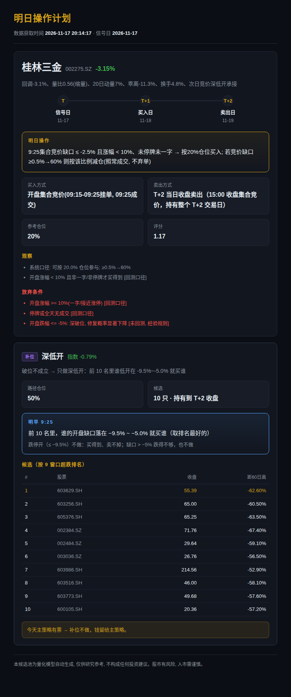

# 第 250 轮 · 网页端那个「每日一个计划」还正常吗

先回答：**主计划照旧，但补位这条腿在页面上是隐形的，而且幂等闸门会把它永久挡住。三处已修。**

---

## 一、页面为什么看不见补位

`site/index.html` 只读一个字段：

```js
const m = d.plans && d.plans.main;     // 就这一行
```

`latest.json` 里新增的 `fillin`（破位 / 深低开的明日名单）它根本不看。后果不是报错，而是**静默漏做**：

| 收盘状态 | 页面显示 | 实际该做的 |
|---|---|---|
| 主策略有票 | 主策略计划 | 主策略（补位让路）✅ |
| 主策略无票、补位有 10 只候选 | **今日无操作计划** | 补位 50% 仓 ❌ |
| 两边都空 | 今日无操作计划 | 空仓 ✅ |

2026-11-17 就是第二种：主策略 `verified` 为空，补位给了 10 只（603629.SH 排第一，距 60 日高 −62.6%）。页面会告诉你今天没事。

已改：`index.html` 新增补位卡（路径、指数位置、仓位、10 只候选表、9:25 规则、跌停开不做），并在三种状态下分别渲染。补位卡底部有一条黄色警示条——**今天主策略有票 → 补位不做，钱留给主策略**（249 定稿 `let_way: false`）。



## 二、更严重的一个：`_fp` 被覆盖了

`daily_run.py` 里 `_fp` 原本是**配置指纹**（`_config_fp(cfg)`），写进 `latest.json` 与 `history.json`。我在接补位时写了：

```python
_fp = fillin.params(cfg)      # ← 把指纹覆盖成了参数字典
```

下游三处立刻错：

```python
if _prev_sig == signal_date and _prev_fp == _fp:   # str == dict，恒 False
    ... 幂等跳过
"config_fp": _fp                                   # 写进 json 的是个对象
if rec["status"] == "无成交" and rec["config_fp"] != _fp:   # 恒 True
```

后果是**幂等闸门彻底失效**：每天五个定时槽全部重算，`history.json` 的 `config_fp` 变成一个对象，第 1162 行"旧口径记录不重判"的保护也失效。已改为 `fp = fillin.params(cfg)`，`_fp` 只留指纹语义。

## 三、还有一层：闸门会跳过，补位块永远不出现

即使修好第二点，11-17 的 `latest.json` 已经在仓库里，`config_fp` 与当前一致 → 下一次运行**幂等跳过**，页面拿到的还是那份没有 `fillin` 的旧 JSON。

`_config_fp()` 只哈希 `universe / selection / execution`，`fillin` 段不在里面。两处一起补：

```yaml
"fillin": [(k, v) for k, v in sorted((cfg.get("fillin") or {}).items())],
"plan_ver": 11,      # 10 → 11，强制重算一次
```

`plan_ver` 本来就是为"产物结构变了必须重算"设的开关（第 176 轮加的），这次正好用它。

## 四、指数索引：str 与 int 只对一个

`market_dist()` 的索引来自 `panel.groupby("trade_date")`，而两条链路的 `trade_date` 类型不同：

| 链路 | trade_date | 取值 |
|---|---|---|
| 回测（`float32=True`） | `str`（按 dates 字符串拼） | `"20261117"` |
| 实盘（`fetch_panel` 非 float32） | `int64`（csv 直读） | `20261117` |

`daily_run` 里我写的是 `int(...)` 取，恰好命中实盘；回测里用 `d` 直接取，恰好命中字符串。**两边都对，靠的是巧合**。任何一边的 dtype 改一下，破位路径就会静默拿到 NaN（`NaN <= -3.51` 为 False），只剩深低开。

已加 `fillin.market_dist()` 出口统一 `astype("int64")` + `fillin.idx_dist_at(dist, date)` 做 `str/int` 归一化查询，两处都改用它。

## 五、验证：拉长面板没动主策略

补位需要 360 日窗口 + 上市 250 日，`daily_run` 的 `warm` 从 30 天拉到 **620 天**，面板从 17 万行变成 **345 万行**。这会改变 `build_indicators` 的输入长度，必须验一遍：

| 指标 | 30 天面板 | 620 天面板 |
|---|---|---|
| 可交易股票 | 5,372 | 5,372 |
| `ma20 / bias20 / dist_high20 / vol_ratio / close_adj` | — | 逐列 `max|Δ| < 1e-6` |
| `bars` | 30 | 620（只用于 ≥21 / ≥250 过滤，判定不变） |

可交易池一模一样，主策略当日的选股不受影响。代价是 `build_indicators` 从 ~1s 变成 26s、`add_indicators` 9s，单次运行多约 45s，90 分钟超时里可忽略。

离线端到端（`tools/scan_250b.py`，620 天真实面板，逐行复制 `daily_run` 的组装代码）：

```
signal_date='20261117'  当日 5580 只
fillin.plan 0.02s  idx_dist=-0.79
路径 深低开  候选 10 只
 1 603629.SH 55.39  -62.6%
 2 603256.SH 65.00  -60.5%
 ...
10 600105.SH 20.36  -57.2%
```

与 `tools/backfill_daily.py` 的名单 **9/10 一致**。差的那只 603629.SH 是 backfill 里 `ntimes`（单票限 8 次）已用满——它从 2019-05 起累计，引擎从回测窗口首日累计。这是 249 已记录的遗留项，不是新问题。

顺带发现一处口径差：backfill 在 `T ∈ {signal, buy}` 时跳过补位，引擎是"T+1 开盘时主策略持仓是否为空"。当 T+1 恰好是主策略的卖出日，引擎允许补位（先卖后买，卖出资金当日可用于买入），backfill 会跳过。这类日子很少（2500 日里个位数），但两边名单对不上会出现在审计里。

## 六、页面三种状态

| 状态 | 渲染 |
|---|---|
| 主策略有票 + 补位有候选 | 主卡 + 补位卡 + 黄色警示「补位不做」 |
| 主策略空仓 + 补位有候选 | 「主策略空仓 · 只做补位」+ 补位卡 |
| 两边都空 | 「今日无操作计划」+ 一行小字说明（补位两条路都不成立） |
| 补位计算异常 | 主卡照常 + 「补位名单计算失败：…（主计划不受影响）」 |

三种状态都用 Chromium 截图核过，表格 10 行、列对齐、警示条、免责声明位置正常。

## 七、没解决的

- **没在真机跑过 `daily_run`**：沙箱没有 `ZZSHARE_TOKEN`，数据源不通。上面所有验证都是拿 `data/panel` 的本地缓存、按 `daily_run` 的同一段代码等价复现的。真链路要等下一次定时任务。
- 补位名单不显示「该票已买满 8 次」。限次在成交时才判（`do_buy_fill`），名单里看不出来；实盘执行时若第一只买不了会自动跳过——但人看页面时不知道。
- 620 天面板让 `daily_run` 峰值内存多约 1.3GB（float64 全列 + 9 个 dh 列）。GitHub runner 7GB 够，但没有做实测压测。
- `fillin.add_indicators` 每次全量重算 9 个窗口（9s）。日更可以接受，若要压时间可以只算当日需要的 60/360 两列——但排名要用全部 9 个窗口，省不掉。

---

**一句话：推送链路本身没坏（Pages 照常部署 6 个 JSON），坏的是「页面对补位的无知」和「闸门会把新字段挡在门外」，以及一个会让每天重算的 `_fp` 覆盖。三处都修了，页面从「一个计划」变成「主计划 + 补位计划」两块。**
