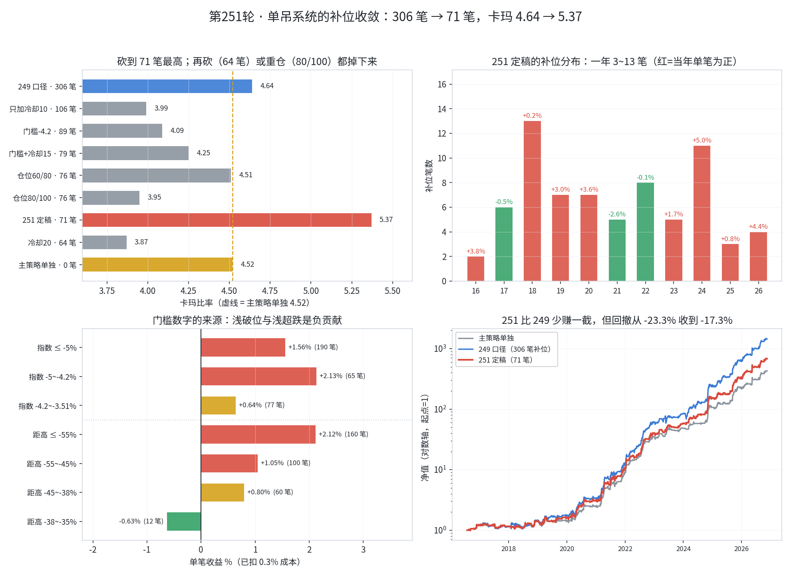
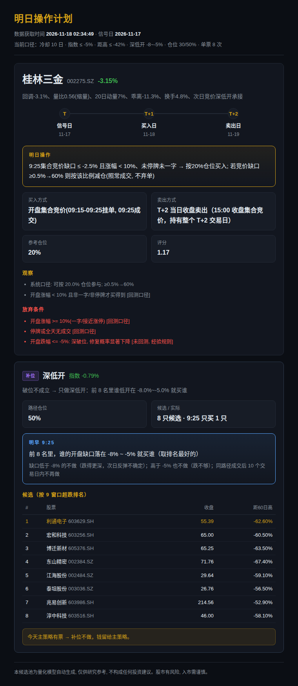

# 第251轮：补位太多 —— 从"补空档"收敛成"极端日伏击"

> 一句话：补位从 306 笔砍到 71 笔（年均 7 笔），卡玛 4.64 → **5.37**，但年化从 108% 掉到 93%。这不是白拿的改善，是拿数量换质量。

## 一、先把"太多"量出来

2500 个交易日里，主策略做了 563 笔（年均 56 笔，每周一单，符合单吊节奏），补位做了 306 笔（年均 30 笔）。合起来 869 笔、年化 108%，但**这套东西已经不是单吊系统了**——它是"主策略为主、补位填缝"的两条腿轮动，平均每 3 个交易日就有一笔。

更具体的问题在破位这条腿。把 2015 年以来所有候选日拉出来看（332 个破位日，含引擎窗口外的 2015 年）：

```
破位 332 笔落在 54 波里（间隔 5 个交易日算同一波）
  1 笔的波   11 个
  2 笔的波    7 个
  3 笔的波    7 个
  4+ 笔的波  29 个     ← 最长的一波连续 23 个交易日都在破位
```

一次暴跌持续两周，就连续买两周。这是**越跌越买的网格摊平**，跟"单吊"（一次一个仓位、一个观点）在风控上是两件事。

## 二、三处漏点，都是数据自己指出来的

把每一个候选日按触发条件分档（489 天全样本），好坏分得很干净：

| 分档 | 笔数 | 单笔 | 胜率 |
|---|---|---|---|
| 指数 ≤ −5% | 190 | +1.56% | 62% |
| 指数 −5 ~ −4.2% | 65 | **+2.13%** | 68% |
| 指数 −4.2 ~ −3.51% | 77 | **+0.64%** | 53% |
| 距高 ≤ −55% | 160 | **+2.12%** | 60% |
| 距高 −55 ~ −45% | 100 | +1.05% | 66% |
| 距高 −45 ~ −38% | 60 | +0.80% | 58% |
| 距高 −38 ~ −35% | 12 | **−0.63%** | 42% |
| 深低开 −9.5 ~ −8% | 22 | **+0.99%** | 59% |
| 深低开 −8 ~ −6.5% | 47 | **+5.19%** | 70% |
| 深低开 −6.5 ~ −5% | 87 | +1.87% | 57% |

- **浅破位**（指数刚过 −3.51）单笔 0.64%，不如不做；
- **浅超跌**（距高 −38 ~ −35）单笔 −0.63%，纯亏；
- **跌停附近的开盘**（−9.5 ~ −8）单笔 0.99%，跌太深接不住。

三处一起收紧：指数 −3.51 → **−5.0%**，距高 −35 → **−42%**，深低开下界 −9.5 → **−8.0%**，深低开名单 10 → **8 名**。

## 三、新机制：同一条腿 10 个交易日内只做一次

门槛只能砍掉"质量差的日子"，砍不掉"同一波里连做"。所以加了冷却：

```yaml
cooldown_days: 10      # 同一条腿成交后 N 个交易日不再做（两条腿各算各的）
```

语义是"一次暴跌只抄一次底"。引擎里记 `fill_last[path]`，成交日写进去，下次 `plan` 时若 `idx - last <= 10` 就丢弃名单。

这一刀的效果比门槛大：破位 227 → 28 笔，深低开 80 → 43 笔。

**试过更"纯"的做法，数据不支持。** 我先把冷却做成全局（任一条腿成交后 10 天内都不做，不管接下来走哪条路）——语义上更贴"一次暴跌只下一次注"。实测：

| 冷却口径 | 补位笔数 | 年化 | 回撤 | 卡玛 |
|---|---|---|---|---|
| 按腿分开（定稿） | 71 | 92.96% | −17.30% | **5.37** |
| 全局（不分腿） | 61 | 94.46% | −20.38% | 4.63 |

全局冷却砍掉的 10 笔（破位与深低开交错的日子）里，有 2018-10-10/11 那种连亏两天（−9.6%、−7.3%），但也有 2024-06-28 的 +14.6%。砍掉之后回撤反而从 −17.3 涨到 −20.4——那 10 笔正好铺在几段回撤里，成了缓冲。所以保留按腿分开。

## 四、结果

| | 总笔数 | 补位 | 年化 | 回撤 | 卡玛 | 正年 |
|---|---|---|---|---|---|---|
| 主策略单独 | 559 | 0 | 84.13% | −18.62% | 4.52 | 10/11 |
| 249 口径（现状） | 869 | 306 | 108.12% | −23.32% | 4.64 | 10/11 |
| **251 定稿** | **631** | **71** | **92.96%** | **−17.30%** | **5.37** | 10/11 |

补位 71 笔 = 破位 28 + 深低开 43，单笔 **1.72%**（249 口径 1.29%）。三个方案都只有 2017 年是亏的（−4.6%），其余年份全正。



**分段验证**（前后各 1250 日）：

| | 前半 年化/回撤/卡玛 | 后半 年化/回撤/卡玛 |
|---|---|---|
| 主策略单独 | 43.7 / −18.6 / **2.34** | 136.1 / −12.6 / **10.84** |
| 251 定稿 | 50.0 / −17.3 / **2.89** | 148.3 / −10.3 / **14.45** |

两段都赢，不是靠某一段撑起来的。回撤还比主策略小 1.3pp——因为补位只发生在主策略空仓期，等于在最差的时候降低了整体风险敞口。

## 五、为什么不用"减仓"换"减笔数"

砍笔数会丢年化，直觉上应该提高单笔仓位补回来。测了：

| 仓位（破位/深低开） | 年化 | 回撤 | 卡玛 |
|---|---|---|---|
| 30% / 50% | 93.24% | −17.30% | **5.39** |
| 60% / 80% | 98.80% | −21.93% | 4.51 |
| 80% / 100% | 102.54% | −25.95% | 3.95 |

年化确实补回来了（93 → 103），但回撤从 −17.3 放大到 −26.0，卡玛反而低于主策略。**补位的质量优势在"小额、分散、只在极端日出场"，一加重仓就变成加杠杆**——这跟 249 轮的结论一致。

## 六、必须说的三件事

**① 砍掉的 235 笔不是噪音。** 它们每笔 +1.29%，是正期望。砍掉它们等于主动放弃 15pp 年化。这笔账换来的是"一年 7 笔"的执行负担和 4.6pp 的回撤。

**② 71 笔里最好 5 笔占 76% 收益。** 去掉最好 5 笔后，剩 66 笔的单笔只有 **0.44%**。也就是说 5.37 这个卡玛，很大程度靠 2024-02-08、2026-01-19 这几笔。中位数只有 +0.86%，比均值 1.72% 低一半——**收益分布是右偏的，别把它当稳定小赚**。

**③ 参数有平台，但 −5.0 这个点是关键。** 同一份数据上：

| 指数阈值 | 距高 −40 | 距高 −45 |
|---|---|---|
| −4.5% | 49 笔 / 1.86% | 42 笔 / 1.43% |
| −5.0% | 39 笔 / 2.23% | 35 笔 / 1.88% |
| −5.5% | 31 笔 / 1.12% | 28 笔 / 1.32% |

−5.0 附近是一个小平台（−42 ~ −45、名单 8 ~ 10 名都能用，实测卡玛 5.37 / 5.39），但放宽到 −4.5 就掉到 4.30。所以定稿取 −5.0 / −42 / −8 / 8 名。

## 七、网页端：文案不再写死，跟 config 走

以前页面上的规则是硬编码的：

```js
const rule = "从上往下，第一只开盘价 ≤ 昨收 × 1.0005 的买入";
const sub  = "跌停开（≤ −9.5%）不做：买得到、卖不掉";
```

改参数之后这两句就成了假话——而且 −8% 根本不是跌停。现在 `latest.json` 的 `fillin` 块多一个 `params`，页面全部由它生成：

```json
"params": {"idx_dist_max": -5.0, "dist_high60_max": -42.0,
           "deep_lo": -8.0, "deep_hi": -5.0, "deep_rank_max": 8,
           "pos_break_pct": 30, "pos_deep_pct": 50,
           "max_times": 8, "cooldown_days": 10, "n1_gap_max": 0.05}
```

页面上因此多了三样东西：

1. **顶部一行"当前口径"**：`冷却 10 日 · 指数 ≤ -5% · 距高 ≤ -42% · 深低开 -8~-5% · 仓位 30/50% · 单票 8 次`——一眼看得出页面跟的是哪一版参数；
2. **9:25 操作框按参数生成**，包括冷却提示；
3. **数据过期黄条**：`update_time` 超过 78 小时（周五收盘到周一开盘最多约 66 小时）就在顶部提示"可能定时任务中断，勿据此下单"。



这是 2026-11-18 02:34 那次 CI 之后线上实际的样子：顶部多了一行"当前口径"，补位卡底部多了一条"今天主策略有票 → 补位不做，钱留给主策略"。

## 八、遗留

- **`backfill_daily.py` 的历史回放与引擎有笔级差异**：脚本判"主策略占用"读的是 `w232_trades.csv`（全期回测），而任意单次回测窗口里主策略的交易序列并不相同。差一笔就会连锁影响 10 日冷却窗口，所以历史审计时个别日期对不上（本次 1200 日窗口：22 天重合、选股 22/22 一致，15 个日期只在一侧出现）。最新交易日的判定不受影响，它只读 `latest.json` 的当日计划。
- **71 笔样本做不了路径拆分统计**：破位 28 笔、深低开 43 笔，各自 t 值都不显著了。249 那时靠 306 笔把深低开做到 t=2.70，现在退回"看整体"。
- **2026 只有 4 笔**（+4.4%/笔），2025 只有 3 笔。极端行情变少时，这条腿会自然哑火——这是设计意图，但要有心理准备：可能连续几个月不开张。

---

最新交易日 **2026-11-17**：等权指数距 20 日线 −0.79%，破位不成立（需 ≤ −5.0%）。排名第一的 603629.SH（利通电子）距 60 日高 −62.6%，前 8 名今天跌幅在 −0.67% ~ −5.49%，无新跌停。

**但今天补位不做**：主策略发了信号（002275.SZ 桂林三金，20% 仓），钱要留给它。页面上补位卡照常列出 8 只候选并标注 `blocked: true`——名单是"如果主策略空仓，明早该看什么"，不是"明早买什么"。
