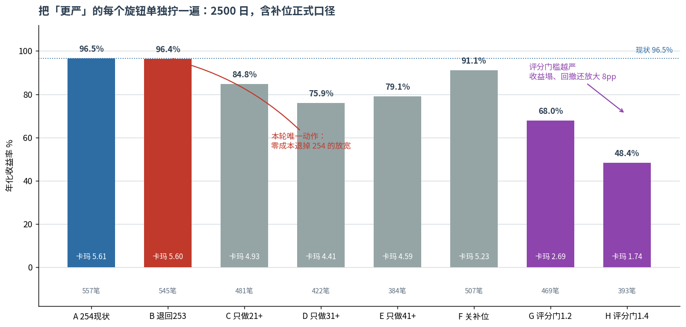
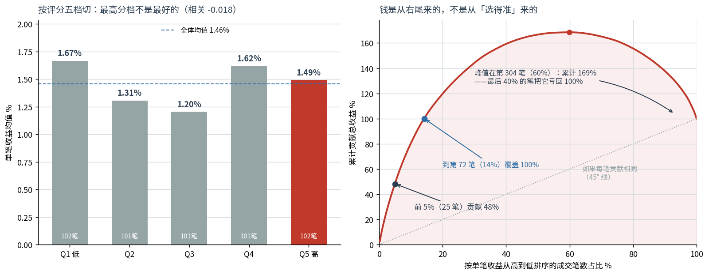
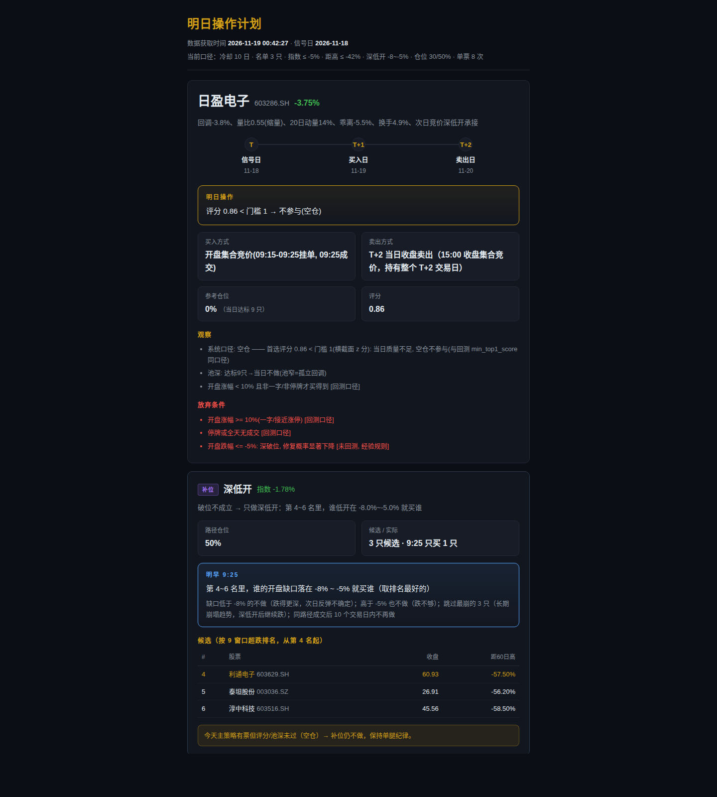

# 第 255 轮：评分不是尺子，是筛子 —— 以及我确实在"加"

> 你的质疑有两半，两半都得答。
>
> **"一直在加"—— 是对的。** 253 把 11-20 只从 0.3 仓提到满仓，254 又把 11-15 只从"不做"提到半仓。两轮方向都是放宽，我还在报告里把它写成"资金利用率提高"。254 那一步的全部收益是 **+0.16pp 年化**，代价是把"更严"改成了"更松"。**这轮退掉。**
>
> **"要评分顶尖的"—— 这条我做不到，而且数据说做了会更差。** 把"更严"的四个旋钮全拧了一遍：只做池深 21+ 掉 11.7pp，评分门槛 1.2 掉 29pp 且回撤恶化 8pp。原因不在执行，在于**评分这把尺子量不出好坏**（与收益相关 −0.018，五档最高分档反而最差）。

先澄清一个可能被误读的事实：**这个系统从来没"多买几只"。** `exec_top_n=1`、`max_buy_per_day=1`，每天最多买 1 只，而且就是当日评分第 1 名。所谓"加股票"，加的是**"有多少天可以买"**，不是"一天买几只"。

---

## 一、认账：254 那一步没有价值，退掉

| 2500 日 | 年化 | 回撤 | 卡玛 | 笔数 | 单笔 |
|---|---|---|---|---|---|
| A 254 定稿（11-15 半仓） | 96.54% | −17.21% | 5.61 | 557 | 1.48% |
| **B 退回 253（11-15 不做）** | **96.38%** | **−17.21%** | **5.60** | **545** | **1.52%** |

差 0.16pp。**为了 0.16pp 把门槛放宽，不值。** 已按 B 改回：

```yaml
pool_n_tiers:
  - {min: 21, mult: 1.00}
  - {min: 11, mult: 1.00}
  - {min: 1,  mult: 0.00}    # 11 只以下不做
```

1500 日复核：**149.61% / −17.21% / 8.69 / 342 笔**（253 当时记 149.76 / 8.70，差 0.15pp 属浮点资金链噪声）。

---

## 二、"更严"的四个旋钮，全拧了一遍



2500 日，正式口径（含补位），只改一个旋钮：

| 方案 | 年化 | 回撤 | 卡玛 | 笔数 | 单笔 |
|---|---|---|---|---|---|
| A 254 现状 | 96.54% | −17.21% | 5.61 | 557 | 1.48% |
| **B 退回 253** | **96.38%** | −17.21% | 5.60 | 545 | 1.52% |
| C 只做池深 ≥21 | 84.80% | −17.21% | 4.93 | 481 | 1.56% |
| D 只做池深 ≥31 | 75.92% | −17.21% | 4.41 | 422 | 1.63% |
| E 只做池深 ≥41 | 79.08% | −17.21% | 4.59 | 384 | 1.79% |
| F 关掉补位腿 | 91.06% | −17.41% | 5.23 | 507 | 1.46% |
| G 评分门槛 1.2 | 67.95% | **−25.27%** | 2.69 | 469 | 1.34% |
| H 评分门槛 1.4 | 48.41% | **−27.74%** | 1.74 | 393 | 1.25% |

**单笔收益是随着收紧单调上升的**（1.48 → 1.79 → 1.52 门槛组反而降），但没一个方案的总收益更好。原因写在下一节。

两处需要单独解释：

**① D（≥31）比 E（≥41）差，不是算错。** 31-40 只这一段是个坑：

| 池深 | 笔数 | 单笔 |
|---|---|---|
| 11-20 | 117 | +1.09% |
| 21-30 | 93 | +1.62% |
| **31-40** | **56** | **+0.68%** |
| 41-60 | 53 | +1.74% |
| 61-100 | 54 | +2.87% |
| 100+ | 35 | +2.18% |

D 把 21-30（1.62%）整段丢掉了，却把 31-40（0.68%）留了进来 —— 两头都做错。这跟第 175 轮"门槛不能低于 40"是同一件事。

**② 评分门槛不但掉收益，还放大回撤。** G 的回撤从 −17.21% 变成 −25.27%，这是本轮最反直觉的发现：**筛掉中段评分的票，剩下的日子集中在高波动时段**，因为极端信号天然扎堆在暴跌行情里。第 230 轮测门槛时只看了年化和卡玛，没注意回撤也在同步恶化。

---

## 三、为什么收紧一定输：单笔 × 笔数 × 复利

这是同一笔账算第四遍了。以"只做 ≥41 只"为例：

- 单笔 1.48% → 1.79%（**+21%**）
- 笔数 557 → 384（**−31%**）
- 乘起来 0.79，再经复利放大，年化从 96.5% 掉到 79.1%

评分门槛更狠：1.52% → 1.25%，545 → 393，两头都掉。

> 每笔赚得多一点，是线性的；少做的那 164 笔里只要有一笔是"三天涨 25%"，复利就把线性优势吃回去了。

---

## 四、评分不是尺子，是筛子



507 笔主策略成交，按评分五等分：

| 分档 | 笔数 | 单笔均值 |
|---|---|---|
| Q1 低 | 102 | +1.67% |
| Q2 | 101 | +1.31% |
| Q3 | 101 | +1.20% |
| Q4 | 101 | +1.62% |
| Q5 高 | 102 | **+1.49%** |

相关系数 **−0.018**。第 230 轮在 559 笔上算出 +0.013，四个窗口、三套配置，结论一致：**门槛以上（score ≥ 1.0）的排序里没有信息。**

但第 230 轮同时证明：**把评分整个拿掉，年化掉 47pp。** 两件事不矛盾 ——

> 评分的作用是**一刀切**：把低于 1.0 的切掉，剩下的一堆差不多。它不是"挑最好的"，是"不买最差的"。

右图是这套系统真正的收益结构（507 笔）：

- 前 5%（25 笔）贡献 **48%** 的总收益；
- 到第 72 笔（14%）就已覆盖 100%；
- 峰值在第 304 笔：累计 169%，**最后 40% 的笔把它亏回 100%**。

**钱是从右尾来的，而右尾是哪只票，评分看不出来。** 这就是"评分顶尖"在这套策略里落不了地的原因：不是我不肯筛，是筛完那批票的暴涨概率并没有更高。

第 235 轮的置换检验也印证了同一件事：真实选中股在池内的分位只有 **55%**，但 5000 次随机抽没有一次追得上 —— 评分**偶尔**选到大奖，不是**经常**选对。

---

## 五、那"精"应该定义在哪

如果"顶尖"指的是**"同一天里有多少只票被打成同一个形态"**（池深），这条线是单调的、有信息量的：

| 池深 | 11-20 | 21-30 | 31-40 | 41-60 | 61-100 |
|---|---|---|---|---|---|
| 单笔 | +1.09% | +1.62% | **+0.68%** | +1.74% | +2.87% |

池深不是"评分更高"，是"今天有更多票同时被错杀"——**恐慌的广度**，而不是**个股的质量**。这是这套策略唯一被反复验证过的 alpha 来源（第 230、234、253 轮同向）。

所以本轮的做法是：**把"精"落在池深门槛上（11 只以下不做），不落在评分门槛上。**

---

## 六、结论与本轮改动

1. **改了**：`pool_n_tiers` 退回 `{21:1.0, 11:1.0, 1:0.0}`，`plan_ver` 19。
2. **没改**：`min_top1_score` 保持 1.0（230 轮已全扫，1.0 是尖峰；本轮 1.2/1.4 再次证伪，且回撤恶化）。
3. **代价**：2500 日 96.54 → 96.38%（−0.16pp），1500 日 152.80 → 149.61%（−3.19pp，与 253 记录一致）。

如果还想更"精"，剩下的只有两个旋钮，价格都在上面表里：

| 选项 | 代价 | 我的看法 |
|---|---|---|
| 关补位腿（只留主策略） | −5.5pp 年化，回撤 −17.41% | 可做，但补位 50 笔里有一部分是股灾月的救命单 |
| 只做池深 ≥21 | −11.7pp 年化 | 不建议，砍掉的是 11-20 只这段正期望（+1.09%） |
| 提高评分门槛 | −29pp 且回撤 +8pp | **不做**，与"更安全"相反 |

顺带一个现成的例子：**今天（2026-11-18）两道门同时关上了。** 首选日盈电子评分 0.86 < 1.0，当日达标票 9 只 < 11 只，参考仓位 0%。这正是"宁可不做"的样子 —— 换成 254 的半仓口径，今天会买 50%，而回测里这一类日子是负期望（6-10 只区间单笔 +0.02%，胜率 43%）。



---

*脚本：`tools/bt_strict_255.py`（8 组对照）、`tools/make_fig_255.py`（两图）。明细：`output/w255_strict_2500*.pkl`、`output/w255_strict_1500_B.pkl`。*
