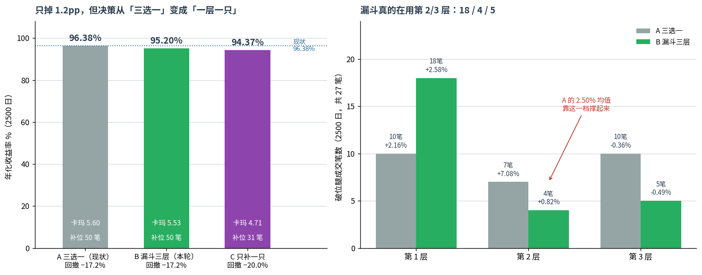
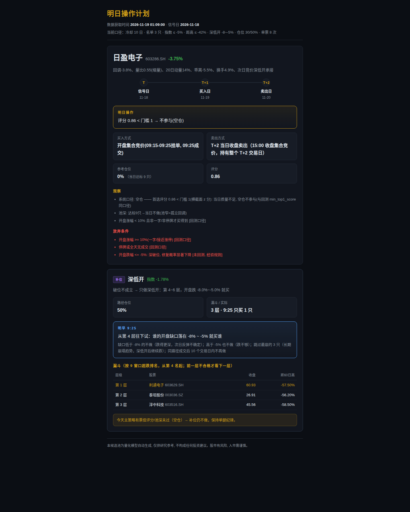

# 第 256 轮：补位改成漏斗 —— 一层一只，最多三层

> 你要的是两件事：**计划别列一堆候选**；**补位一个一个来，最多三层**。
>
> 我把两种都跑了。结论有点反直觉：**"只留一个补位"这条路更差，而且差在回撤上**（−17.21% → −20.03%）。
> 所以落地的是第二种 —— **漏斗三层：每层 1 只，前一层不合格才看下一层**。代价 1.18pp 年化，回撤不变。



---

## 一、三种形态，2500 日实测

| 方案 | 年化 | 回撤 | 卡玛 | 笔数 | 补位 | 破位 | 深低开 | 补位单笔 |
|---|---|---|---|---|---|---|---|---|
| A 现状：3 只里挑开盘最低 | 96.38% | −17.21% | 5.60 | 545 | 50 | 27 | 23 | 1.71% |
| **B 漏斗三层：一层一只** | **95.20%** | **−17.21%** | **5.53** | 545 | 50 | 27 | 23 | 1.30% |
| C 只补一只（1 层） | 94.37% | **−20.03%** | 4.71 | 526 | 31 | 22 | **9** | 1.75% |

1500 日同向：

| | 年化 | 回撤 | 卡玛 | 补位 |
|---|---|---|---|---|
| A | 149.61% | −17.21% | 8.69 | 29 |
| **B** | **149.30%** | **−17.21%** | **8.67** | 29 |
| C | 149.38% | **−20.03%** | 7.46 | **17** |

**B 在 1500 日只掉 0.31pp**，2500 日掉 1.18pp，回撤一分没动。

**C 的问题不在收益，在回撤**：1500 日收益只差 0.23pp，但回撤多 2.8pp、卡玛从 8.67 掉到 7.46。原因在深低开那条腿 —— 从 23 笔砍到 9 笔，砍掉的是"第 5、第 6 层才接得住"的那些天，而那些天恰好是股灾月。

---

## 二、现状那 3 只，其实是"三选一"，不是"三层"

252 轮为了把补位池从 10 只压到 3 只，把破位腿改成了 `pick_break=lowest`：**3 只里挑开盘最低的那只**。

这一点在数据上很漂亮，在最差的一半上很危险：

| 破位腿 27 笔 | 第 1 名 | 第 2 名 | 第 3 名 |
|---|---|---|---|
| A（三选一） | 10 笔 +2.16% | 7 笔 **+7.08%** | 10 笔 **−0.36%** |
| B（漏斗） | **18 笔 +2.58%** | 4 笔 +0.82% | 5 笔 −0.49% |

A 的 2.50% 均值，**是靠第 2 名那 7 笔 7.08% 撑起来的**——去掉这一档就只剩 0.9%。这是极值依赖，不是稳定 alpha。

B 的形态更干净：第 1 层 18 笔 2.58%，后两层只是"第 1 层不合格时的替补"，合计 9 笔、均值接近零，不指望它们赚钱，只指望它们不让当天开天窗。

**深低开腿本来就是漏斗**（一直是 `pick_deep=best`），所以 A→B 在它身上一分没变：23 笔 = 第 4 名 8 笔 + 第 5 名 6 笔 + 第 6 名 9 笔，单笔 0.77%。这 23 笔里有 15 笔来自第 2/3 层 —— **漏斗不是形式，是真的在用。**

---

## 三、落地

`config.yaml`：

```yaml
fillin:
  list_n: 3          # 破位名单 = 漏斗层数
  deep_rank_max: 3   # 深低开名单 = 漏斗层数
  deep_skip: 3       # 深低开从第 4 名起（跳过最崩的 3 只）
  pick_break: best   # 256: lowest -> best，即"按名次逐层试"
  pick_deep: best
```

`choose()` 本来就是"从上往下挑第一只合格的"，`best` 就是这个语义 —— 这轮没有改引擎，只把**挑法**从"三选一"切回"逐层递补"，再把页面说清楚。

页面（补位卡）：

- 标题：`漏斗（按 9 窗口超跌排名，从第 4 名起；前一层不合格才看下一层）`
- 表格第一列：`第 1 层 / 第 2 层 / 第 3 层`（不再是名次号）
- 明早 9:25：`从第 4 层往下试：谁的开盘缺口落在 −8% ~ −5% 就买谁`
- 右上角：`3 层 · 9:25 只买 1 只`



---

## 四、结论

1. **已改**：补位 = 漏斗三层，一层一只，最多三层。`plan_ver` 22。
2. **没做**：把补位砍到 1 只 —— 它省不了多少（1500 日只差 0.23pp），却让回撤多 2.8pp。
3. **代价**：2500 日 −1.18pp 年化（96.38 → 95.20），1500 日 −0.31pp，回撤不变。这笔钱买的是"早上不用三选一"。

如果你还是想要更少，`list_n: 1` / `deep_rank_max: 1` 一行就能切到 C，但我建议不要 —— C 在 1500 日和 2500 日的回撤都是 −20.03%，比现在多亏 2.8pp。

---

*脚本：`tools/bt_funnel_256.py`（3 组 × 2 窗口）、`tools/make_fig_256.py`。明细：`output/w256_funnel_2500.pkl`、`output/w256_funnel_1500.pkl`。*
